<picture>
  <source media="(prefers-color-scheme: dark)" srcset="assets/header-dark.svg">
  <source media="(prefers-color-scheme: light)" srcset="assets/header-light.svg">
  
</picture>

## 👋 About me

- 🐍 Backend developer: Python services and Telegram bots on **FastAPI**, **aiogram** and **PostgreSQL / SQLite**.
- 🤖 I connect LLM APIs (Claude, Gemini, OpenAI) to real products and build MCP servers.
- 🐧 Ubuntu + GNOME every day: I write my own GNOME Shell extensions and keep my whole setup in one install script.
- 📚 Learning DevOps step by step, with notes and labs in public: [DevOps Course](https://nureke666.github.io/DevOps-Course/).

## 📚 Learning DevOps

My course with notes and hands-on labs: **[nureke666.github.io/DevOps-Course](https://nureke666.github.io/DevOps-Course/)**

| Status | Topics |
|---|---|
| ✅ **Learned, with practice** | Linux (systemd, nginx, LVM, cgroups, SELinux on Rocky Linux) · Git |
| 🔄 **Learning now** | Bash |
| 🧰 **Already use in projects** | Docker · Docker Compose · GitHub Actions |
| 🗺️ **Next** | Networking (TCP/IP, DNS, TLS, HAProxy, WireGuard) · Docker & CI/CD in depth · Ansible · Kubernetes · Terraform · Monitoring |

  
  
  
  
  
  
  

## 🛠 Tech stack

  
  
  

  
  
  
  
  
  
  

  
  
  
  

## 🚀 Projects

<table>
  <tr>
    <td width="50%" valign="top">

**[📚 DevOps-Course](https://github.com/nureke666/DevOps-Course)** 
My DevOps study notes and labs (in Russian), built with VitePress and published on GitHub Pages. 
`VitePress` · `GitHub Actions` · `GitHub Pages`

</td>
    <td width="50%" valign="top">

**[🤖 personal-tg-bot](https://github.com/nureke666/personal-tg-bot)** 
Personal Telegram assistant: tasks with reminders, countdowns, finances with Excel/CSV export, habits. 
`aiogram 3` · `SQLite` · `pytest` · `Docker` · `GitHub Actions`

</td>
  </tr>
  <tr>
    <td width="50%" valign="top">

**[🧩 ExtensionsUbuntu](https://github.com/nureke666/ExtensionsUbuntu)** 
GNOME Shell extensions for Ubuntu 24.04 on Wayland: i3-style auto-tiling, drop-down terminal, notification island, screenshot paste. 
`JavaScript` · `GNOME Shell 46` · `Shell`

</td>
    <td width="50%" valign="top">

**[🖥️ terminal-backup](https://github.com/nureke666/terminal-backup)** 
My Ubuntu setup in one script: GNOME Terminal themes, keybindings, GNOME extensions, bashrc and a Nerd Font. 
`Bash` · `dconf` · `GNOME`

</td>
  </tr>
</table>

## 🐍 Contributions

<picture>
  <source media="(prefers-color-scheme: dark)" srcset="https://raw.githubusercontent.com/nureke666/nureke666/output/github-snake-dark.svg">
  <source media="(prefers-color-scheme: light)" srcset="https://raw.githubusercontent.com/nureke666/nureke666/output/github-snake.svg">
  
</picture>
